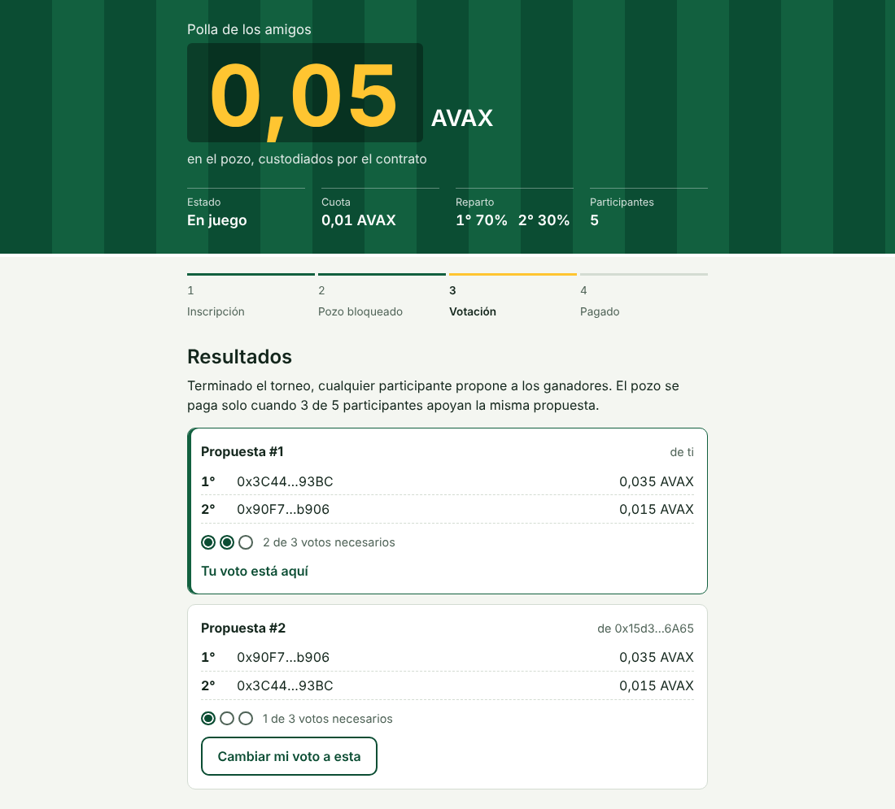
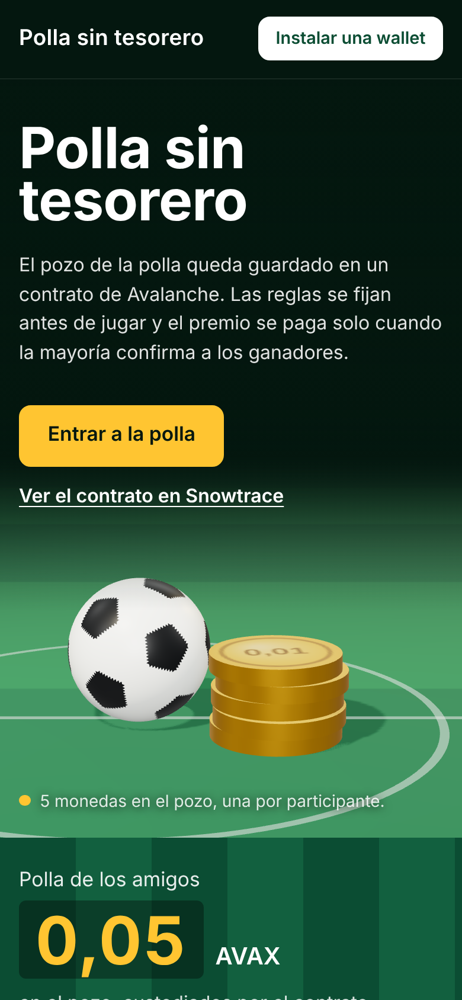

<p align="center">
  <a href="https://polla-sin-tesorero.vercel.app">
    
  </a>
</p>

<p align="center">
  <a href="https://polla-sin-tesorero.vercel.app"><strong>Abrir la demo</strong></a>
  &nbsp;&nbsp;|&nbsp;&nbsp;
  <a href="https://testnet.snowtrace.io/address/0x5C32584E07C5Fc54c8B2c2Bdd235fa054Cb3d883">Contrato verificado en Snowtrace</a>
</p>

# Polla sin tesorero

**Un grupo de amigos custodia el pozo de su polla en un smart contract y lo reparte solo cuando la mayoría confirma a los ganadores. No hay tesorero de confianza.**

Proyecto para el Chile Team1 Avalanche Hackathon, del curso Aplicaciones de Blockchain y Criptomonedas (IN3863).

| | |
| --- | --- |
| Contrato en Fuji | `0x5C32584E07C5Fc54c8B2c2Bdd235fa054Cb3d883` (código verificado) |
| Ver en Snowtrace | https://testnet.snowtrace.io/address/0x5C32584E07C5Fc54c8B2c2Bdd235fa054Cb3d883 |
| Transacción de ejemplo|https://testnet.snowtrace.io/tx/0xba963294488d8e8784ce194640dcd847fd5d892648d0a31770d723b17f943bed |
| Demo | https://polla-sin-tesorero.vercel.app |
| Video | _COMPLETAR_ |
| Red | Avalanche Fuji C-Chain (testnet), Chain ID 43113 |

## El problema

En toda polla alguien guarda la plata. Ese "tesorero" puede demorarse en pagar, equivocarse en el reparto, desaparecer con el pozo o simplemente generar desconfianza. Además, los porcentajes de premio se acuerdan de palabra y se pueden discutir al final.

## La solución

El pozo vive en un contrato inteligente en Avalanche:

1. **Reglas fijas desde el inicio.** Al crear la polla se fijan la cuota (por ejemplo, 0,01 AVAX) y el reparto (por ejemplo, 70 % para el 1° y 30 % para el 2°). Nadie puede cambiarlos después.
2. **Entrar es aceptar.** Cada amigo entra depositando exactamente la cuota. Si no le gustan las reglas, no entra.
3. **Pozo bloqueado.** Cuando están todos, cualquier participante cierra la inscripción. Desde ahí nadie puede sacar la plata por su cuenta.
4. **Oráculo humano.** Terminado el torneo, un participante propone a los ganadores mirando la tabla de la polla. Si alguien propone algo falso, los demás no lo apoyan y pueden proponer el resultado correcto: las propuestas compiten y cada persona tiene un solo voto, que puede cambiar.
5. **Pago automático.** Apenas una propuesta tiene el apoyo de **más de la mitad** de los participantes, el contrato paga a los ganadores en esa misma transacción.

## Así se ve

La portada muestra el pozo como una torre de monedas en 3D: hay una moneda por cada participante inscrito en el contrato, y cuando alguien se une cae una moneda nueva. Más abajo está la polla en vivo: el marcador con el pozo, las propuestas de ganadores y los votos, que se muestran como una tanda de penales.

| Votación en curso | En el celular |
| --- | --- |
|  |  |

## Cómo está hecho

```
polla-mundial/
├── contracts/      Smart contract (Solidity 0.8.28) con Hardhat 3 + viem
│   ├── contracts/PollaMundial.sol
│   ├── test/PollaMundial.ts          20 pruebas automáticas
│   └── ignition/modules/PollaMundial.ts
└── web/            Página en Next.js + wagmi + viem, con portada 3D en Three.js
```

| Función del contrato | Qué hace |
| --- | --- |
| `constructor(nombre, cuota, porcentajes)` | Crea la polla con reglas fijas. Los porcentajes deben sumar 100. |
| `unirseYAportar()` | Te inscribe depositando exactamente la cuota. |
| `iniciarPolla()` | Un participante cierra la inscripción y bloquea el pozo. |
| `proponerGanadores([1°, 2°, ...])` | Propone ganadores. Proponer cuenta como tu voto. |
| `confirmarResultados(id)` | Apoya una propuesta. Con mayoría, paga automáticamente. |

Eventos registrados en Snowtrace: `PollaCreada`, `ParticipanteUnido`, `PollaIniciada`, `PropuestaCreada`, `VotoEmitido`, `PollaLiquidada` y `PremioPagado`.

## Correrlo en tu computador

Requisitos: Node.js 22 o superior.

**Contrato (pruebas locales, no gastan nada):**

```bash
cd contracts
npm install
npx hardhat test
```

**Web:**

```bash
cd web
npm install
cp .env.example .env.local     # en Windows: copy .env.example .env.local
# edita .env.local y pega la dirección del contrato
npm run dev                     # abre http://localhost:3000
```

Las variables `NEXT_PUBLIC_CONTRACT_ADDRESS` y `NEXT_PUBLIC_CHAIN_ID=43113` son públicas: solo llevan la dirección del contrato y el número de red, nunca claves.

## Seguridad y limitaciones (prototipo)

- Es una testnet: los AVAX de prueba no tienen valor.
- El estado pasa a "pagada" **antes** de transferir, así que nadie puede volver a entrar al contrato a mitad del pago (protección contra reentrada).
- El contrato confía en que la mayoría diga la verdad. Si la mayoría se pone de acuerdo para mentir, gana la mayoría: es la regla que el grupo acepta al entrar.
- Si el grupo nunca llega a acuerdo, el pozo queda bloqueado. Una siguiente versión podría agregar un plazo con devolución automática.
- Si un ganador fuera otro contrato que rechaza pagos, el reparto no se ejecutaría. Entre amigos con wallets normales no ocurre.
- No está auditado. No usar con dinero real sin una auditoría.

## Equipo

- Agustín Arraño
- Lucas Escobar
- Martín Ibeas
- Rafaela Quintana
- Christian Valenzuela
